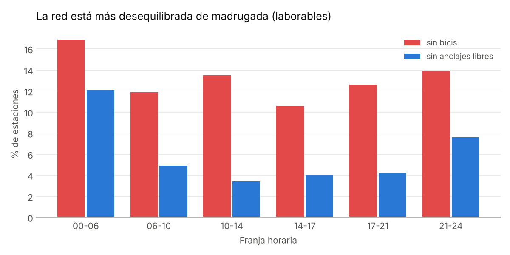
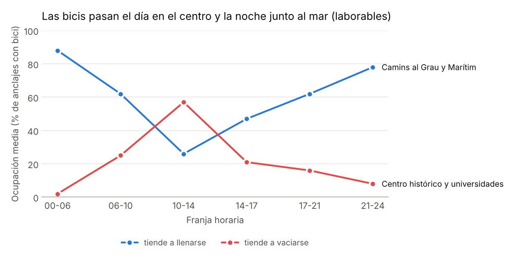
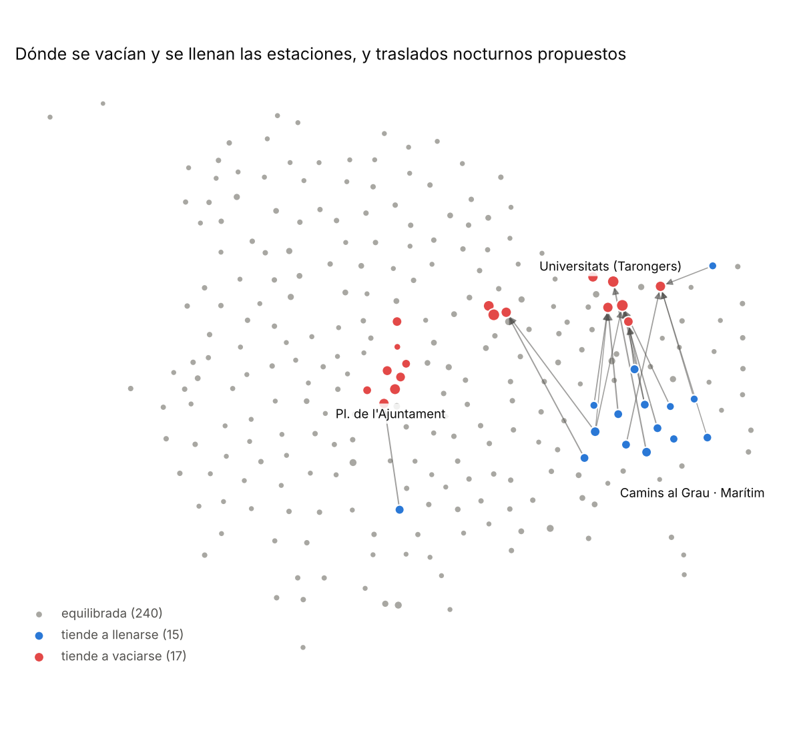
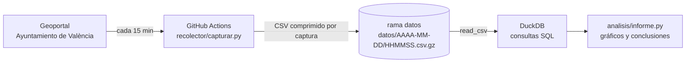

# 🚲 Valenbisi · Análisis para la redistribución de bicis

[](https://github.com/RicardoEdreiraPenas/valenbisi-analisis-redistribucion/actions/workflows/recolectar.yml)
[](https://github.com/RicardoEdreiraPenas/valenbisi-analisis-redistribucion/actions/workflows/tests.yml)


> **Informe con datos del 1 de octubre al 9 de noviembre de 2026.** El recolector sigue funcionando y el informe se puede regenerar con los datos nuevos (ver [Reproducir el análisis](#reproducir-el-análisis)).

Un sistema de bici compartida tiene un problema operativo diario: unas estaciones se vacían y otras se llenan, y hay que mover bicis en furgoneta para equilibrarlas. Este proyecto responde, con datos reales de **Valenbisi** (València), a la pregunta que se haría un responsable de operaciones:

**¿Qué estaciones se quedan vacías o llenas, cuándo ocurre, y cómo organizar la redistribución?**

## Resumen

- **El desequilibrio es un péndulo diario.** En laborables, 17 estaciones del centro histórico y de la zona universitaria de Tarongers están casi vacías de madrugada (2 % de ocupación) y se llenan a mediodía (57 %). Otras 15 de Camins al Grau y el Marítim hacen lo contrario: 88 % de madrugada y 26 % a mediodía.
- **El peor momento es la madrugada, no la hora punta.** De 00:00 a 06:00 en laborables, el 16,9 % de las estaciones no tiene bicis y el 12,1 % no tiene anclajes libres. A mediodía son el 13,5 % y el 3,4 %.
- **Redistribución nocturna propuesta:** mover **52 bicis** de 15 estaciones excedentarias, casi todas del Marítim, sobre todo a la zona universitaria, en 17 traslados de 1,5 km de media (unas 3 cargas de furgoneta). Para dejar todas las estaciones problemáticas al 30 % hacen falta **139 bicis**: las 87 restantes tienen que salir del almacén o de estaciones equilibradas, sobre todo para el centro histórico, que no tiene ninguna estación excedentaria cerca.
- **La calidad del dato limita la precisión.** GitHub Actions ejecutó solo el 5,2 % de las capturas programadas. Los patrones son claros y coherentes, pero cada cifra por estación y franja se apoya en 10 a 37 capturas.

## Hallazgos

### 1. ¿Son fiables los datos?

| Indicador | Valor |
| --- | --- |
| Capturas recogidas | 194 de 3.715 programadas (5,2 %) |
| Lecturas de estación | 52.962, de 273 estaciones |
| Capturas por franja (laborables) | entre 10 (14-17 h) y 37 (00-06 h) |
| Estaciones que no informan | 1: la 70 (Colón con Almirante Roger de Lauria) marca 0 bicis y 0 anclajes y la fuente no la actualiza desde el 17/09/2026. Se excluye. |
| Anclajes averiados | el 33,4 % de las lecturas tiene algún anclaje fuera de servicio (0,67 de media por estación) |

GitHub retrasa y omite muchas ejecuciones programadas cada 15 minutos. Por eso los promedios por estación **ponderan igual las seis franjas horarias**: si no, las horas de madrugada, que tienen más capturas, pesarían más.

### 2. ¿Qué estaciones fallan más?

Porcentaje del tiempo en laborables con la estación vacía (0 bicis) o llena (0 anclajes libres). Se marca como problemática la que pasa vacía al menos el 30 % del tiempo (17 estaciones) o llena al menos el 20 % (15 estaciones). Las otras 240 están equilibradas.

| Más tiempo vacías | % | Más tiempo llenas | % |
| --- | ---: | --- | ---: |
| 105 Av. de los Naranjos | 50 | 84 Serrería esq. Pintor Ferrer Calatayud | 31 |
| 113 ETS Caminos | 44 | 151 Jerónimo Monsoriu | 27 |
| 112 Av. de los Naranjos | 44 | 068 Av. del Puerto IV | 26 |
| 87 Av. Blasco Ibáñez 2 | 39 | 069 Av. del Puerto | 25 |
| 40 C/ Barcas, frente al Teatro Principal | 38 | 162 Pza. Armada Española | 25 |
| 015 Ribera | 38 | 073 Jerónimo Monsoriu | 25 |

Ranking completo en [`resultados/`](resultados/).

### 3. ¿A qué horas pasa?



La red acumula el desequilibrio durante la tarde y la noche y lo arrastra hasta la mañana. En fin de semana es menor (12,0 % vacías y 8,0 % llenas de madrugada) porque faltan los desplazamientos al trabajo y a la universidad.

### 4. ¿Dónde?



Las estaciones que se vacían son destinos de día: universidades y centro histórico. Las que se llenan están en barrios residenciales cerca del mar. Por la mañana las bicis salen de Camins al Grau y el Marítim, y por la tarde vuelven. Quien quiere salir del centro de noche no encuentra bici, y quien llega al Marítim de noche no encuentra anclaje.

### 5. ¿Cómo redistribuir?



**Objetivo:** dejar al final de la noche las estaciones que se vacían al **30 %** de su capacidad y las que se llenan al **70 %**. No se sube al 50 %: las estaciones universitarias reciben llegadas toda la mañana y a mediodía rondan el 60-70 %, así que necesitan anclajes libres.

| | Bicis |
| --- | ---: |
| Necesitan las 17 estaciones que se vacían | 139 |
| Sobran en las 15 estaciones que se llenan | 52 |
| Traslados propuestos (17, distancia media 1,5 km) | 52 |
| Por cubrir desde almacén o estaciones equilibradas | 87 |

Los traslados emparejan primero las estaciones más cercanas. 48 de las 52 bicis van del Marítim a la zona universitaria y Blasco Ibáñez, a 0,6-2,2 km. Las otras 4 van de Av. Ausiàs March a Estación Renfe I. Las estaciones del centro histórico (Ribera, Barcas, Pza. del Ajuntament) quedan más lejos de cualquier estación excedentaria y conviene abastecerlas desde el almacén.

El objetivo del 30/70 % y la furgoneta de 20 bicis son supuestos de este análisis, no datos de Valenbisi. Detalle de cada traslado en [`resultados/05_redistribucion_traslados.csv`](resultados/05_redistribucion_traslados.csv).

### Limitaciones

- Con un 5 % de cobertura, las cifras por estación y franja son orientativas. Las conclusiones de grupo (el péndulo y el peor momento de madrugada) se repiten en todas las franjas y tipos de día.
- Los datos dan el estado de cada estación, no los viajes. Los flujos se deducen de cómo cambia la ocupación.
- No se conocen las rutas reales de la furgoneta ni el almacén. Las distancias son en línea recta.

## Cómo está hecho

Cada pregunta se responde con una consulta SQL en DuckDB en [`sql/`](sql/). El script [`analisis/informe.py`](analisis/informe.py) las ejecuta en orden, guarda cada resultado en [`resultados/`](resultados/), empareja los traslados y genera los gráficos de [`docs/img/`](docs/img/).

## Cómo se recogen los datos



- Un workflow de **GitHub Actions** ejecuta `recolector/capturar.py` cada 15 minutos, sin servidores propios.
- Cada captura se guarda como un CSV comprimido en la rama [`datos`](https://github.com/RicardoEdreiraPenas/valenbisi-analisis-redistribucion/tree/datos). La rama principal solo contiene el código y el análisis.
- Las horas se guardan en **hora local de València**. También se guarda la última actualización de cada estación según la fuente, para descartar estaciones que no informan.
- GitHub puede retrasar u omitir alguna ejecución programada. Por eso el análisis empieza midiendo la cobertura real.

### Columnas

| Columna | Descripción |
| --- | --- |
| `momento` | Hora local de la captura |
| `estacion_id`, `nombre`, `direccion` | Identificación de la estación |
| `latitud`, `longitud` | Coordenadas (WGS84) |
| `bicis` | Bicis disponibles |
| `anclajes_libres` | Anclajes libres para dejar una bici |
| `capacidad` | Anclajes totales (bicis + libres puede ser menor si hay anclajes averiados) |
| `abierta` | Si la estación está en servicio |
| `actualizado_fuente` | Última actualización de la estación según la fuente |

## Ejecutarlo en local

```bash
pip install -r requirements-dev.txt
python recolector/capturar.py datos   # una captura en datos/
pytest -q
```

## Reproducir el análisis

Los datos están en la rama `datos`. Se pueden traer a una carpeta aparte con un worktree:

```bash
git fetch origin datos
git worktree add ../valenbisi-datos datos
pip install -r requirements-analisis.txt
python analisis/informe.py ../valenbisi-datos/datos
```

## Proyecto relacionado

[valenbisi-data-pipeline](https://github.com/RicardoEdreiraPenas/valenbisi-data-pipeline): pipeline en tiempo real con MongoDB, PostgreSQL, dbt y un mapa interactivo sobre la misma fuente de datos.

## Datos

Fuente: [ValenBisi Disponibilidad](https://opendata.vlci.valencia.es/dataset/valenbisi-disponibilitat-valenbisi-dsiponibilidad), Ajuntament de València, con licencia [CC BY 4.0](https://creativecommons.org/licenses/by/4.0/deed.es). Los datos recogidos en la rama `datos` mantienen esa licencia; el código del repositorio tiene licencia MIT.

## Autor

**Ricardo Edreira Penas** · Data Analyst · Data Engineer Junior
[LinkedIn](https://www.linkedin.com/in/ricardoedreira) · [GitHub](https://github.com/RicardoEdreiraPenas)
